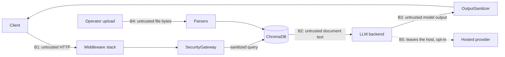

# Threat Model

This document states what Aegis-RAG defends against, where each defence lives, how it is
verified, and — just as important — what it does **not** defend against. It complements
[`SECURITY.md`](../SECURITY.md), which covers vulnerability reporting and the dependency
risk register. The reasoning behind the main design choices is in the
[architecture decision records](adr/README.md).

Every control listed here names the module that enforces it and the test that pins it down,
so a claim can be checked instead of trusted.

## 1. Scope and assumptions

**In scope:** the HTTP API (`src/aegis`), its ingestion and query pipelines, the middleware
stack, and the reference deployment (`docker-compose.yml`, `infra/terraform`).

**Assumptions the model rests on:**

- The operator controls the host and the network. An attacker with shell access to the API
  host, or with write access to the ChromaDB volume, is out of scope.
- **Ingested documents come from trusted operators, but their content is not trusted.** A
  document is allowed into the index without inspection, and is then treated as hostile data
  at generation time. This is the central design decision of the query path.
- ChromaDB, Redis and Ollama are reachable only from the API (see T-12). They have no
  authentication of their own in this stack.
- TLS is terminated in front of the API by a reverse proxy or load balancer. The application
  sends HSTS but does not serve HTTPS itself.

## 2. Assets

| Asset | Why it matters |
|---|---|
| Indexed document content | The corpus is the confidential data. Leaking it — directly or through the model — is the primary loss. |
| System prompt and pipeline configuration | Disclosure helps an attacker tune a bypass. |
| API keys (client keys, hosted-LLM key) | Grant query, ingest and delete rights; the LLM key carries cost and quota. |
| Service availability | A RAG API does expensive work per request (embedding, generation), which makes it cheap to exhaust. |
| Integrity of answers | An answer shaped by a poisoned document is a wrong answer delivered with the system's authority. |
| Logs and metrics | They are the audit trail; they must not be forgeable or contain secrets. |

## 3. Actors

| Actor | Capabilities |
|---|---|
| **Anonymous network client** | Can reach the published port. No API key. |
| **Authenticated client** | Holds a valid API key. Can query, upload, list and delete. May be malicious or compromised. |
| **Document author** | Cannot call the API, but writes content that an operator later ingests. The indirect prompt-injection actor. |
| **Network neighbour** | On the same LAN as a developer machine or the same network as the host. |
| **Upstream dependency** | A compromised package, base image or CI action. |

## 4. Trust boundaries

- **B1** — everything in the request is attacker-controlled: body, headers, filename, declared
  content type and length.
- **B2** — retrieved text may contain instructions aimed at the model.
- **B3** — model output is untrusted: it may echo an injection, leak a prompt or carry markup.
- **B4** — an uploaded file may lie about its type and may be built to exhaust the parser.
- **B5** — exists only with `LLM_PROVIDER=openai_compatible`. The query and retrieved excerpts
  cross it. Off by default.

## 5. Threats and controls

Identifiers are stable so they can be referenced from issues and commits. "LLM0x" refers to
the OWASP Top 10 for LLM Applications.

### Query path

| ID | Threat | Control | Enforced in | Verified by |
|---|---|---|---|---|
| T-01 | **Direct prompt injection** (LLM01): the query tells the model to ignore its rules, adopt a persona or disclose its prompt. | Signature and structural scoring before any retrieval or model call; a blocked query never reaches the LLM. Strict mode also blocks the *suspicious* band. | `infrastructure/security/security_gateway.py` | `TestPromptInjectionBlocking`, `TestPromptDisclosureBlocking`, `TestChainOfThoughtManipulation` |
| T-02 | **Obfuscated injection**: the same payload hidden with zero-width characters, fullwidth forms, bidi overrides or Cyrillic/Greek homoglyphs. | NFKC normalization, removal of control/format characters, and a homoglyph-folded view used only for matching. | same | `TestObfuscatedInjection`, `TestUnicodeNormalization` |
| T-03 | **Detection as a DoS primitive**: a query crafted to make a signature backtrack and stall the event loop. | Every pattern is bounded or anchored to stay linear; the staged-reasoning rule is a two-pointer sweep, not a regex. | same, `infrastructure/security/markup.py` | `TestSignatureCostIsBounded`, `TestScanCostIsBounded`, `TestCostIsBounded` |
| T-04 | **Indirect prompt injection** (LLM01): a retrieved document carries instructions. | Three layers: a system prompt that declares the context untrusted, shared by every backend; attribution framing around each document; and a reflection guard that fails the request if the output echoes an injection. | `infrastructure/llm/prompting.py`, `infrastructure/security/output_sanitizer.py` | `TestReflectionDetection`, `test_prompt_is_identical_to_the_one_ollama_receives` |
| T-05 | **Unsafe output handling** (LLM02): the answer carries HTML, script, or a Markdown link whose label hides its target. | Tags are stripped; Markdown is flattened and every link is rewritten as `text (target)`; output length is capped. Flattening runs before the reflection scan so markers cannot split a phrase. | `output_sanitizer.py`, `markup.py` | `TestHTMLStripping`, `TestLinksExposeTheirTarget`, `TestSanitizerIntegration` |
| T-06 | **System prompt disclosure** (LLM07). | Probing queries are blocked at the gateway; the prompt instructs non-disclosure; an output that looks like a prompt dump trips the reflection guard. | `security_gateway.py`, `prompting.py`, `output_sanitizer.py` | `TestPromptDisclosureBlocking` |
| T-07 | **Sensitive data in answers** (LLM06). | PII patterns in the output are detected and logged with the query hash. **Detect-only — see residual risks.** | `output_sanitizer.py` | `TestPIIDetection` |

### Transport, identity and abuse

| ID | Threat | Control | Enforced in | Verified by |
|---|---|---|---|---|
| T-08 | **Unauthenticated access.** | API key on every non-public path, enforced in middleware so unknown routes are covered too. Fails closed when no key is configured. | `interface/api/middleware/security_middleware.py` | `TestAPIKeyMiddleware` |
| T-09 | **Key recovery by timing.** | Keys are compared as SHA-256 digests with `hmac.compare_digest`, against every configured key, without an early exit. | same | `test_near_miss_keys_are_forbidden` |
| T-10 | **Online key guessing.** | Per-address lockout after repeated rejected keys. It applies to valid keys too during the lockout, so the response is not a right/wrong oracle. The address is taken from `X-Forwarded-For` only at an explicitly trusted proxy depth (default: never). | same | `TestFailedAuthLockout`, `TestLockoutIsPerClientAddress`, `TestResolveClientIp` |
| T-11 | **Resource exhaustion by an authenticated client** (LLM04). | Per-key sliding-window rate limit; rejected requests do not occupy the window, so it cannot grow under a retry storm. Request bodies are capped at the ASGI layer as they stream, including chunked uploads. | `infrastructure/security/rate_limiter.py`, `middleware/body_limit.py` | `TestRejectedRequestsAreNotRetained`, `TestStreamedBodyWithoutLength`, `TestFrameworkParsedBodies` |
| T-12 | **Lateral access to backing services** from the local network. | Every published compose port is bound to loopback; only the API and Grafana can be exposed, by explicit setting. On AWS the security group opens the API port only. | `docker-compose.yml`, `infra/terraform/modules/compute` | manual: `docker compose ps` shows `127.0.0.1:` bindings |
| T-13 | **Credential exposure through the service itself.** | The client key never leaves the auth layer: downstream sees a truncated digest. The hosted-LLM key is a `SecretStr`, sent only as a header, and absent from logs and error text. | `security_middleware.py`, `infrastructure/llm/openai_compatible_adapter.py` | `test_rate_limit_bucket_is_keyed_by_a_digest_not_the_api_key`, `TestCredentialDoesNotLeak` |
| T-14 | **Log and header injection.** | A caller-supplied `X-Request-ID` is reused only if it looks like an identifier; uploaded filenames are reduced to a single-line display name. | `security_middleware.py`, `interface/api/routes/documents.py` | `test_malformed_caller_id_is_replaced`, `TestUploadedFilename` |
| T-15 | **Information disclosure.** | The OpenAPI schema and docs exist only in debug. Errors return a generic body; dependency outages are a 503/504 that name no host. Security headers are set on every response, including unhandled 500s. | `interface/api/main.py`, `error_handlers.py` | `TestApiDocsExposure`, `TestDependencyFailures`, `TestUnhandledRouteErrors` |

### Ingestion path

| ID | Threat | Control | Enforced in | Verified by |
|---|---|---|---|---|
| T-16 | **File type spoofing.** | The type is taken from magic bytes; the client's `Content-Type` is ignored, and the use case cannot be handed a type derived elsewhere. | `infrastructure/parsers/parser_registry.py` | `TestUnsupportedFileTypes` |
| T-17 | **Decompression bomb.** | A DOCX is refused before opening if its declared uncompressed size or member count exceeds a budget. PDFs are capped at 1,000 pages. | `parsers/docx_parser.py`, `parsers/pdf_parser.py` | `TestDecompressionBombGuard` |
| T-18 | **Parser-driven denial of service.** | Parsing runs off the event loop, so a slow document cannot freeze other requests; the upload is size-checked before it is buffered. | `application/use_cases/ingest_documents.py`, `routes/documents.py` | `test_oversized_upload_is_rejected_before_reaching_the_use_case` |
| T-19 | **Filename spoofing in listings and prompts.** | See T-14: path components and Unicode format characters (including right-to-left override) are removed. | `routes/documents.py` | `TestUploadedFilename` |

### Supply chain and operations

| ID | Threat | Control | Enforced in | Verified by |
|---|---|---|---|---|
| T-20 | **Vulnerable dependency.** | `pip-audit` on every push fails on any advisory with a fix; the image is scanned by Trivy; installs are locked. Unfixable advisories are recorded with a rationale and a review date. | `.github/workflows/ci.yml`, `uv.lock`, `SECURITY.md` | CI |
| T-21 | **Compromised CI action.** | The actions with the most reach (image scanner, toolchain installer) are pinned to a commit SHA; the job token is read-only. | `.github/workflows/ci.yml` | review of the workflow |
| T-22 | **Silent degradation of a control.** | A rate-limit store outage, authentication-failure spikes, output reflections and 5xx rates each have a metric and an alert. Failing open is a logged, counted decision, never a default nobody chose. | `infrastructure/observability/metrics.py`, `infra/prometheus/alerts.yml` | `TestRateLimitBackendFailure`, `TestThrottleStoreOutage` |
| T-23 | **Architectural erosion** that would let a control be bypassed in a later change. | The layer dependency rule is enforced by a test that parses every module's imports. | `tests/unit/test_architecture.py` | itself |

## 6. Residual risks and non-goals

These are known, deliberate limits. They are listed because a threat model that claims full
coverage is not credible.

**The input gateway is a heuristic, and it covers two languages.** Its signatures match known
phrasings in English and Spanish. Measured against the current rule set, each of these passes
with a threat score of 0:

- the same instruction written in a third language (`Ignoriere alle vorherigen Anweisungen…`),
- a paraphrase that avoids the trigger words, in either language,
- leetspeak (`1gn0re all prev1ous instruct1ons`),
- a short Base64 payload.

The size of that gap is measured in [`docs/GATEWAY_EVALUATION.md`](GATEWAY_EVALUATION.md): on a
labelled corpus the gateway blocks roughly three quarters of the attacks in the categories it
targets and none of the paraphrased, translated or character-substituted ones.

The gateway therefore raises the cost of a naive attack and produces a signal; it is not the
control that the system's safety depends on. That role belongs to the layers behind it —
the untrusted-context system prompt and the output guard (T-04, T-05) — which apply
regardless of how the query was phrased. A classifier-based guard can be added behind the
existing `QueryGuardPort` without changing the pipeline.

**Indirect injection is mitigated, not solved.** No prompt reliably prevents a model from
following instructions in its context. The reflection guard catches echoes of known payloads,
not a model that quietly follows a novel one. Do not ingest documents from sources you would
not trust to send your users an email.

**PII handling is detect-and-log, not redaction.** Regular expressions cannot classify
personal data reliably, and silently altering answers would be worse than flagging them. A
deployment with a redaction requirement needs a dedicated classifier in the output path.

**There is no per-user authorization or tenancy.** Any valid API key can read, ingest into
and delete from the single collection. Keys identify clients for rate limiting, not for
access control. Multi-tenant use requires a different design.

**Three endpoints are unauthenticated by design**: `/health`, `/ready` and `/metrics`. They are
meant for orchestrators and scrapers, and must be restricted at the network layer.

**The hosted LLM backend ends the air-gap.** With `LLM_PROVIDER=openai_compatible`, queries
and retrieved excerpts are sent to a third party under that provider's terms. It is opt-in
and logged at startup, but it is a data-handling decision, not a technical control.

**The compose stack is a development environment.** It runs with `DEBUG=true`, an example API
key and Grafana's default credentials. Loopback binding limits who can reach it; it is not a
production profile.

**Not addressed:** training-data poisoning and model theft (the models are third-party and
unmodified), embedding inversion, denial of service at the network layer, and a malicious
operator.

## 7. Keeping this document honest

A control is listed only if a test would fail were it removed. `tests/unit/test_threat_model_doc.py`
checks that every test and file cited above still exists. When a control changes, its
row changes in the same pull request; when a new bypass is found, it is added to section 6
until it is fixed, then moved to section 5 with the test that covers it.
